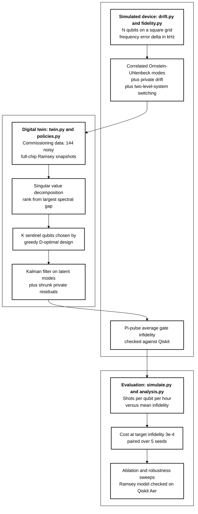
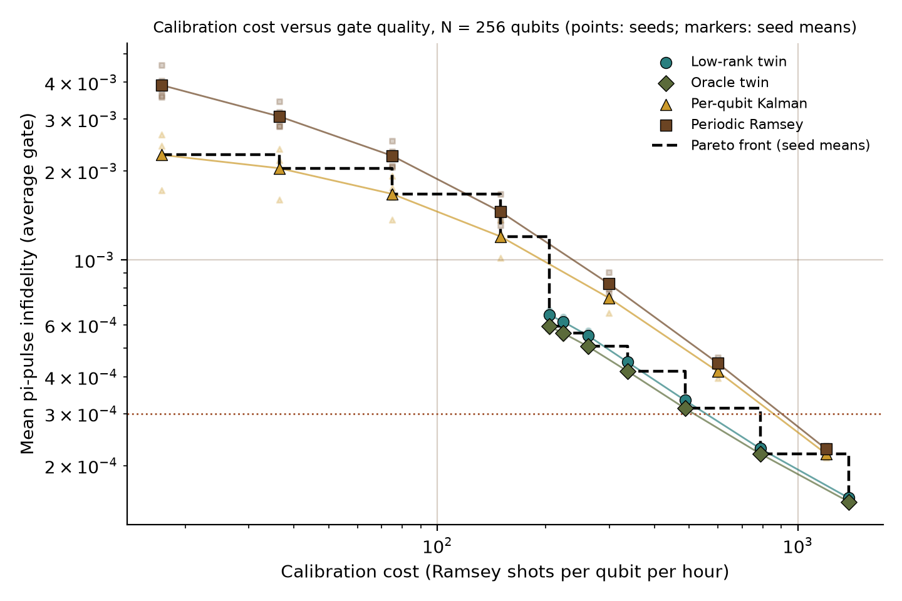
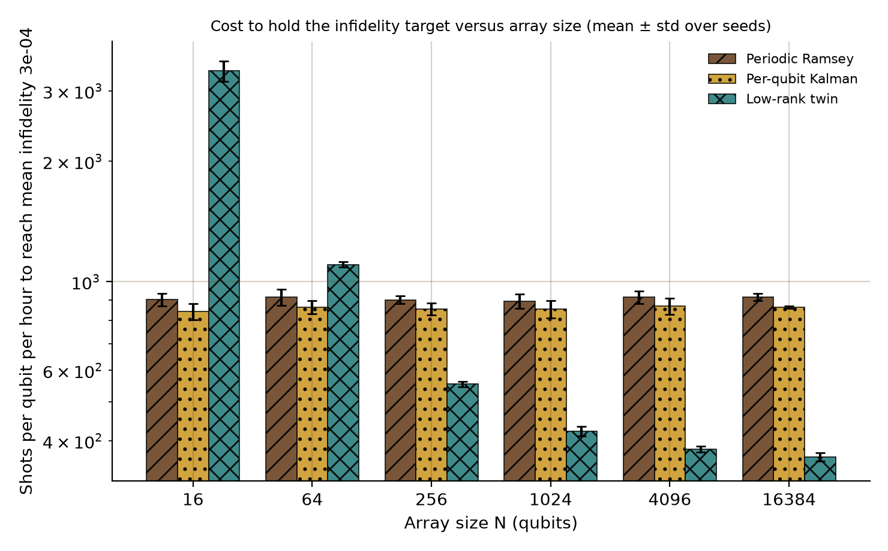
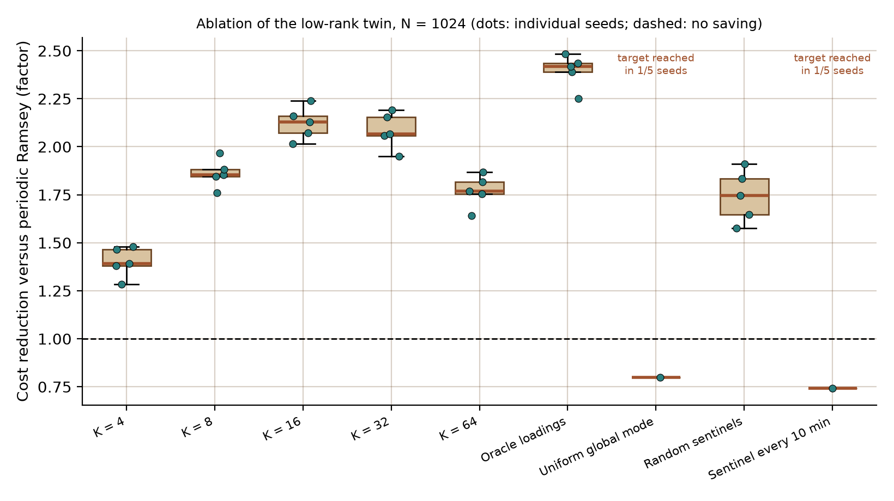
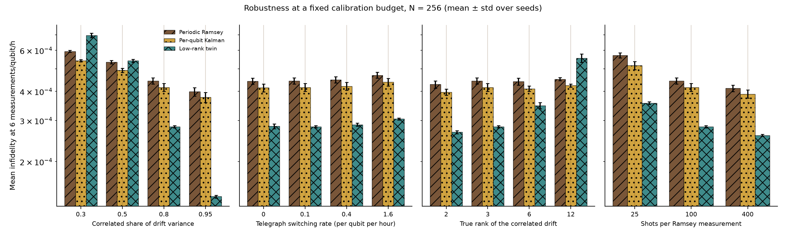

# Low-Rank Digital Twin of Correlated Qubit Drift: Sentinel-Based Recalibration from 16 to 16 384 Qubits

[](LICENSE)
[](https://www.python.org/)
[](https://github.com/pradeepdegalaroyal/low-rank-drift-twin-sentinel-recalibration/actions/workflows/ci.yml)

## Abstract

Keeping every qubit of a large array calibrated costs measurement time that grows with the number of qubits, so control stability at scale is limited by how cheaply drift can be tracked. This simulation study tests whether a learned low-rank digital twin of correlated frequency drift, updated from a few sentinel qubits, lowers the Ramsey shots per qubit per hour needed to hold a mean pi-pulse infidelity of 3e-4, compared with periodic Ramsey recalibration and a per-qubit Kalman twin. In simulation the twin needs 2.40 ± 0.06 times fewer shots than periodic recalibration at 4096 qubits and 2.51 ± 0.06 times fewer at 16 384 qubits, but it is worse below about 100 qubits, and the saving vanishes when the correlated share of the drift variance falls to 50 % or below.

## Motivation

Arrays of individually controlled qubits have grown from 51 atoms to 256 atoms (Bernien et al., 2017, digital object identifier (DOI) 10.1038/nature24622; Ebadi et al., 2021, DOI 10.1038/s41586-021-03582-4) and 53 superconducting qubits (Arute et al., 2019, DOI 10.1038/s41586-019-1666-5). Reviews of superconducting, circuit-quantum-electrodynamics and trapped-ion hardware list control errors, decoherence and scalable control as open problems (Huang et al., 2020, DOI 10.1007/s11432-020-2881-9; Blais et al., 2020, DOI 10.1038/s41567-020-0806-z; Bruzewicz et al., 2019, DOI 10.1063/1.5088164). If each qubit must be re-measured on its own schedule, the control layer of a million-qubit machine spends its bandwidth on calibration. A digital twin that predicts drift from cheap measurements could relieve this, provided it is validated against the device it models.

## Research gap

Among the papers in the literature set used here, the hardware papers calibrate and verify each qubit individually. Recent software papers either simulate the quantum state, whose cost still grows exponentially with qubit number (Verma and Rahwani, 2027, DOI 10.1007/978-3-032-30963-1_32), or audit program semantics (Zhang and Chen, 2027, DOI 10.1007/978-3-032-30693-7_17). A trainability result shows that exploiting locality can turn exponential into polynomial scaling (Cerezo et al., 2021, DOI 10.1038/s41467-021-21728-w), a lesson that has not been applied to calibration cost. None of these papers measures how the cost of keeping the control layer stable scales with qubit number, or whether a model of the low-rank structure of correlated drift can replace per-qubit measurements. The full related-work table and hypotheses are in [`docs/RESEARCH_GAP.md`](docs/RESEARCH_GAP.md).

### What is new here

* A paired, equal-infidelity comparison of calibration *measurement cost* (not simulated-state cost) over array sizes from 16 to 16 384 qubits.
* A sentinel-driven Kalman twin of a learned low-rank drift subspace, with the rank selected from data, compared against a per-qubit Kalman twin that is blind to correlations.
* An explicit map of where the saving disappears: too few sentinels, a uniform-mode assumption, slow sentinel sampling, a small correlated variance share, and a true rank above the twin's capacity.

## Hypotheses

* **H1 (scaling):** the twin needs fewer shots than periodic recalibration at the target infidelity once N is large enough to amortise the sentinel cost, with a saving that saturates at a floor set by private drift.
* **H2 (structure matters):** the saving comes from the learned low-rank structure and good sentinel placement.
* **H3 (limits):** the saving disappears when the correlated variance share is small or the true rank exceeds what the twin and its sentinels can represent.

## Method



*Legend: kHz = kilohertz; D-optimal = design that maximises the determinant of the information matrix; Ramsey = free-induction frequency measurement.*

**Device.** Each qubit's frequency error is a sum of three low-rank Ornstein-Uhlenbeck (OU) modes with spatially smooth loadings (60 min correlation time), a private OU term (30 min), and two-level-system (TLS) switching of 40 kHz at 0.1 per qubit per hour. The total root-mean-square (rms) drift is 120 kHz with 80 % of the variance correlated. A resonant 2 MHz pi pulse driven with frequency error eps has the closed-form average gate infidelity used throughout, checked against `qiskit.quantum_info.average_gate_fidelity` (maximum absolute difference 2.6e-16 over six detunings, `results/validation_gate.csv`). A Ramsey estimate with S shots is modelled as Gaussian with standard deviation 1 / (2 pi tau sqrt(S)); on the Aer simulator the empirical-to-model standard-deviation ratio is between 0.92 and 1.02 for 25, 100 and 400 shots (`results/validation_ramsey.csv`).

**Policies.** (i) *Periodic Ramsey*: each qubit re-measured every P minutes (staggered), value held; this is the standard practice baseline. (ii) *Per-qubit Kalman*: same schedule with shrinkage and decay from a fitted per-qubit OU model (classical baseline). (iii) *Low-rank twin*: singular value decomposition (SVD) of commissioning data gives a rank-r basis; K = 16 sentinel qubits are measured every 2 min; a Kalman filter tracks the r latent coordinates; each qubit's correction is the latent prediction plus a shrunk, decayed private residual measured on the same staggered schedule as the baselines. (iv) *Oracle twin* with true loadings as an upper bound. Full details: [`docs/METHOD.md`](docs/METHOD.md).

**Metric.** Primary: shots per qubit per hour needed to reach a mean infidelity of 3e-4 (log-log interpolation along the period sweep P = 5 to 320 min), all policies on a shared drift trace per seed so ratios are paired. Mean ± standard deviation over seeds (5 seeds; 3 at N = 16 384).

## Results

All numbers below are read from files in `results/`; everything is simulation, not hardware.

### Cost-quality frontier at N = 256



*Takeaway: at N = 256 the twin shifts the cost-quality frontier below the two baselines for infidelities under about 6e-4, while at the cheapest budgets the baselines are on the front.*

Cost at target (`results/pareto_cost_at_target.csv`, shots per qubit per hour, 5 seeds):

| Policy | Cost at mean infidelity 3e-4 |
|---|---|
| Periodic Ramsey | 900.5 ± 20.0 |
| Per-qubit Kalman | 854.1 ± 29.5 |
| Low-rank twin (learned, rank 3 selected on every seed) | 555.1 ± 9.6 |
| Oracle twin (true loadings) | 514.0 ± 8.7 |

### Scaling with array size



*Takeaway: the twin loses below about 100 qubits because sentinel shots dominate, wins from 256 qubits, and its advantage saturates near 2.5 times.*

Cost at target in shots per qubit per hour (`results/scaling_cost_at_target.csv`) and paired reduction versus periodic Ramsey (`results/scaling_reduction.csv`):

| N | Periodic Ramsey | Per-qubit Kalman | Low-rank twin | Reduction versus periodic | Reduction versus Kalman |
|---|---|---|---|---|---|
| 16 | 901.3 ± 32.5 | 841.3 ± 38.6 | 3365.7 ± 194.5 | 0.27 ± 0.01 | 0.25 ± 0.01 |
| 64 | 914.0 ± 42.8 | 863.2 ± 33.4 | 1103.8 ± 16.7 | 0.83 ± 0.04 | 0.78 ± 0.03 |
| 256 | 900.0 ± 19.8 | 854.4 ± 28.9 | 554.3 ± 8.4 | 1.62 ± 0.03 | 1.54 ± 0.04 |
| 1024 | 893.6 ± 38.3 | 854.1 ± 42.5 | 422.1 ± 11.6 | 2.12 ± 0.08 | 2.02 ± 0.07 |
| 4096 | 915.0 ± 33.3 | 867.4 ± 40.0 | 380.5 ± 6.6 | 2.40 ± 0.06 | 2.28 ± 0.08 |
| 16 384 (3 seeds) | 914.8 ± 19.8 | 863.1 ± 6.1 | 364.7 ± 8.6 | 2.51 ± 0.06 | 2.37 ± 0.04 |

The per-qubit Kalman twin is within about 7 % of periodic recalibration at every size: modelling each qubit alone gains little, the saving comes from sharing information across qubits.

**Cost model beyond the simulated range** (`results/extrapolation_cost_model.csv`; *modelled, not simulated*, assuming rank stays 3 and K = 16 sentinels measured every 2 min): the twin's cost approaches 361.8 shots per qubit per hour at 1 048 576 qubits against 914.8 for periodic recalibration, i.e. an array-wide Ramsey rate of 105 380 versus 266 450 shots per second.

### Ablation (N = 1024)



*Takeaway: a moderate sentinel count and a learned basis matter; sampling sentinels slowly or assuming a uniform global mode removes the saving.*

Reduction versus periodic Ramsey at target 3e-4 (`results/ablation_reduction.csv`):

| Variant | Reduction (mean ± std) | Seeds reaching target |
|---|---|---|
| K = 4 sentinels | 1.40 ± 0.08 | 5/5 |
| K = 8 | 1.86 ± 0.07 | 5/5 |
| K = 16 (default) | 2.12 ± 0.09 | 5/5 |
| K = 32 | 2.08 ± 0.09 | 5/5 |
| K = 64 | 1.77 ± 0.08 | 5/5 |
| Oracle loadings (K = 16) | 2.40 ± 0.09 | 5/5 |
| Random sentinels (K = 16) | 1.74 ± 0.13 | 5/5 |
| Uniform global mode (K = 16) | 0.80 (single seed) | 1/5 |
| Sentinels every 10 min (K = 16) | 0.74 (single seed) | 1/5 |

In the two variants that miss the target on 4 of 5 seeds, the best mean infidelity reached anywhere on the sweep is 3.4e-4 (uniform mode) and 3.1e-4 (slow sentinels), against 1.6e-4 for the default twin (`results/ablation_best_point.csv`).

### Robustness at N = 256



*Takeaway: the twin is robust to telegraph switching and to the measurement-noise level, but not to a small correlated share or to a true rank well above the number of modes it can track.*

Cost at target in shots per qubit per hour (`results/robustness_cost_at_target.csv`; "n/r" = target not reached by any setting on the sweep):

| Stressor | Setting | Periodic Ramsey | Per-qubit Kalman | Low-rank twin |
|---|---|---|---|---|
| Correlated variance share | 0.3 | n/r | 1140.5 ± 13.2 | 1299.7 ± 6.6 |
| | 0.5 | 1083.9 ± 10.0 | 1026.3 ± 18.2 | 1084.8 ± 10.2 |
| | 0.8 (default) | 900.0 ± 19.8 | 854.4 ± 28.9 | 554.3 ± 8.4 |
| | 0.95 | 806.4 ± 26.6 | 767.4 ± 36.3 | 204.1 ± 0.0 (cheapest setting already meets the target) |
| TLS switching per qubit per hour | 0 | 896.1 ± 19.6 | 850.2 ± 28.5 | 559.1 ± 16.8 |
| | 1.6 | 950.5 ± 18.2 | 902.3 ± 28.0 | 612.5 ± 8.6 |
| True rank of correlated drift | 2 | 877.3 ± 28.6 | 821.6 ± 22.7 | 517.9 ± 11.8 |
| | 6 | 895.0 ± 20.8 | 846.7 ± 17.4 | 723.9 ± 23.6 |
| | 12 | 914.1 ± 9.1 | 869.8 ± 10.0 | 1066.8 ± 38.9 (4 of 5 seeds reach target) |
| Shots per Ramsey measurement | 25 | n/r | n/r | 212.2 ± 7.4 |
| | 400 | 3224.5 ± 77.8 | 3089.1 ± 101.5 | 2031.7 ± 31.2 |

The infidelity at a fixed budget of six Ramsey measurements per qubit per hour (`results/robustness_summary.csv`) orders the policies the same way, as shown in the figure.

## Discussion

H1 is supported in simulation: the paired reduction exceeds 1 from N = 256 and reaches 2.51 ± 0.06 at N = 16 384, but it saturates, because the private drift (20 % of the variance plus switching) still needs per-qubit recalibration; the modelled cost at one million qubits is within 1 % of the 16 384-qubit value. H2 is partly supported. The learned basis is what makes the twin work: a uniform global mode and slow sentinel sampling both fail to reach the target on 4 of 5 seeds. Random sentinels, however, keep about two thirds of the saving (1.74 versus 2.12), so careful placement is a secondary effect, and 16 to 32 sentinels are near the optimum at N = 1024 (K = 64 is worse, 1.77, because its sentinel cost is no longer amortised). H3 is supported: at a correlated share of 0.5 the twin is no better than periodic recalibration, at 0.3 it is worse than the per-qubit Kalman twin, and with a true rank of 12 (the twin's rank-selection cap) it is worse than periodic recalibration; telegraph switching 16 times above the default costs the twin about 10 % more shots (612.5 versus 554.3).

Negative results to note: the twin is 3.7 times more expensive than periodic recalibration at 16 qubits (reduction 0.27), the per-qubit Kalman baseline brings no meaningful gain, and the twin's cost-at-target depends on the sentinel schedule (a 10 min interval fails). The twin also helps less than the oracle at every size (2.12 versus 2.40 at N = 1024), so part of the loss is estimation of the basis from 144 noisy snapshots.

## Limitations

* **Simulation only.** No physical device was used. The drift generator is linear-Gaussian plus telegraph switching, which matches the twin's model class and favours it; a real device with non-Gaussian, non-stationary or nonlinear drift will show smaller savings. Qiskit and Aer validate the gate-error formula and the Ramsey-estimator noise model, not the drift model.
* **Illustrative parameters** (2 MHz Rabi frequency, 1 us Ramsey time, 120 kHz drift) for a slow-gate platform; no platform was calibrated.
* **Fixed rank growth assumption.** The cost model for 262 144 and 1 048 576 qubits assumes the correlated rank stays at 3 and 16 sentinels suffice; real chips may need more modes as they grow, and the rank-12 result shows what happens then.
* **Single-qubit gate error only**; no two-qubit gates, crosstalk, or readout drift. Cost counts Ramsey shots, not wall-clock time, parallelism limits or classical control bandwidth.
* The N = 16 384 point uses 3 seeds and a shorter period sweep (5 to 40 min).
* The infidelity target of 3e-4 and the six-measurements-per-hour budget were chosen after a pilot run to lie inside the range all policies span; results at other targets are in `results/*.csv` for the sweeps only.

## Future work

* Replace the linear-Gaussian twin with a recurrent or state-space neural twin and compare on drift data from a real device; the pipeline (commissioning snapshot, rank selection, sentinel design, filter) maps onto a calibration database kept by a lab control system.
* Co-design the sentinel set with the control-hardware multiplexing so that K Ramsey measurements run in parallel across readout lines, and track how the number of latent modes scales with chip area.
* Extend the device model to two-qubit gate parameters, crosstalk and readout, and validate with density-matrix simulation of small blocks.
* Add online detection of unmodelled switching events so that the twin triggers per-qubit recalibration only when a residual test fails.

Related work by the author (shot-budget and calibration-style studies): [`joint-fit-interleaved-rb-coherent-error`](https://github.com/pradeepdegalaroyal/joint-fit-interleaved-rb-coherent-error) and [`anytime-valid-shot-stopping-quantum-circuit-tests`](https://github.com/pradeepdegalaroyal/anytime-valid-shot-stopping-quantum-circuit-tests).

## Reproducibility

```bash
pip install -r requirements.txt
pip install -e .
pytest -q                                   # 9 fast tests
python experiments/run_all.py --quick       # smoke run, < 1 minute, writes results_quick/ and figures_quick/
python experiments/run_all.py               # full study, writes results/ and figures/
python experiments/run_all.py --analyse-only  # rebuild tables and figures from results/*.csv
```

The full sweep took 356.5 s (`results/summary.json`) with four worker processes on a Windows 11 laptop (16 threads, central processing unit only; the graphics processor is not used). Seeds are 0 to 4; the drift trace, commissioning data and measurement noise are all derived from the seed. Dependencies are pinned in `requirements.txt` (Python 3.11.9, numpy 2.2.6, scipy 1.17.1, pandas 2.3.3, matplotlib 3.11.1, qiskit 2.4.2, qiskit-aer 0.17.2).

## Project structure

```
src/calibtwin/   fidelity.py (pi-pulse infidelity), drift.py (device model), twin.py (SVD twin, sentinels),
                 policies.py (controllers), simulate.py (paired trials), analysis.py, validate.py (Qiskit/Aer), plotting.py
experiments/     run_all.py (one command reproduces everything)
tests/           test_calibtwin.py
docs/            RESEARCH_GAP.md, METHOD.md
results/         raw and summarised tables, summary.json
figures/         fig1 to fig4 (200 dpi)
```

## Citation

```bibtex
@software{degala_lowrank_drift_twin_2026,
  author  = {Degala, Chenchupradeep},
  title   = {Low-Rank Digital Twin of Correlated Qubit Drift: Sentinel-Based Recalibration from 16 to 16 384 Qubits},
  year    = {2026},
  version = {0.1.0},
  url     = {https://github.com/pradeepdegalaroyal/low-rank-drift-twin-sentinel-recalibration},
  license = {MIT}
}
```

MIT license (`LICENSE`). Citation metadata is also in `CITATION.cff`.
